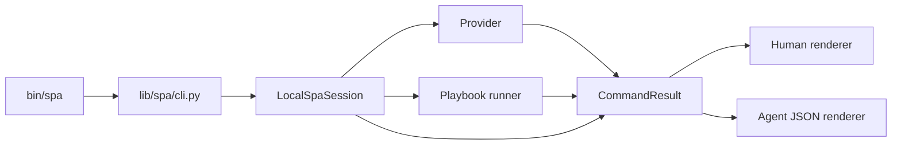
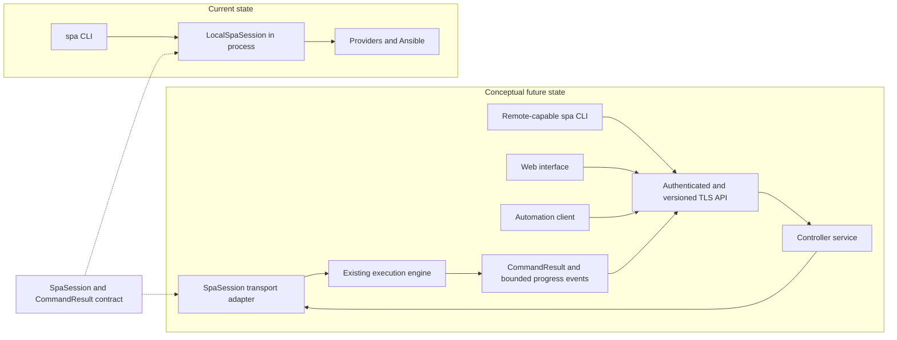
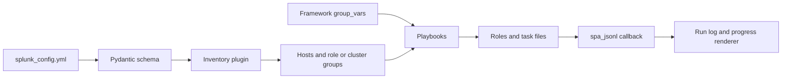

# SPA architecture and contributor standards

This page is for contributors changing the Splunk Platform Automator framework. Operators should use the [user guide](user-guide.md). Command and setting reference material is generated in [commands.md](commands.md) and [config.md](config.md); do not duplicate or hand-edit it.

Related guides cover [installation](install.md), [migration](migrate.md), [apps](apps.md), [AWS](aws.md), [secrets](secrets.md), the normative [config-editing.md](config-editing.md) contract, and detailed [contributing procedures](contributing.md). Future product work belongs in the [ROADMAP](../ROADMAP.md).

## Current execution architecture

`spa` is the only operator entry point. The binary resolves the framework and environment, the CLI parses one action, and the local session owns command behavior and confirmation. Providers and Ansible perform infrastructure or host work. The CLI renders the resulting `CommandResult` for a human or as the agent JSON envelope.

The main modules have these responsibilities:

- [`bin/spa`](../bin/spa) selects a usable SPA virtual environment and enters the Python CLI.
- [`lib/spa/cli.py`](../lib/spa/cli.py) owns argument parsing, command routing, and human/agent presentation.
- [`lib/spa/api.py`](../lib/spa/api.py) defines the `SpaSession` port, `CommandResult`, `LocalSpaSession`, and `open_session()`.
- [`lib/spa/agent.py`](../lib/spa/agent.py) owns `COMMAND_SCHEMA`, agent detection, and JSON envelope emission.
- [`lib/spa/catalog.py`](../lib/spa/catalog.py) renders the configuration schema and feature catalog.
- [`lib/spa/providers/`](../lib/spa/providers) dispatches provider-specific infrastructure operations.
- [`lib/spa/playbooks.py`](../lib/spa/playbooks.py) catalogs, resolves, and runs Ansible playbooks.
- [`lib/spa/runlog.py`](../lib/spa/runlog.py) normalizes progress events and persists run logs.

Skills and agents call `bin/spa`; they do not import `spa.api`. This keeps them on the same parsing, validation, confirmation, redaction, and envelope path as a human operator.

## Command lifecycle

The CLI parses an action and calls the corresponding `SpaSession` method. The session returns a JSON-serializable `CommandResult`; it does not print the final response. The CLI then renders human text or one agent JSON object.

Confirmation belongs at the session boundary in [`lib/spa/confirm.py`](../lib/spa/confirm.py), not in a renderer. A mutating agent call supplies `--yes`; an agent or GUI never answers an interactive `Proceed?` prompt. This rule applies equally to direct CLI use and any future transport.

Public command behavior follows these status contracts:

- Exit `0`: success or explicit help.
- Exit `2`: command usage error.
- Exit `1`: runtime, provider, validation, or execution failure.
- Agent failure: one `{"ok":false,"schema_version":1,"error":"..."}` object with no `data`.
- Catalog commands expose an explicit `list` action.

See [Adding a spa command](contributing.md#adding-a-spa-command) for the parser, schema, documentation, and test procedure.

## Controller architecture

The current CLI calls `LocalSpaSession` in-process. `SpaSession` is the backend port, while `CommandResult` and progress callbacks form the transport-safe result contract. [`tests/test_spa_api.py`](../tests/test_spa_api.py) keeps the protocol and local implementation signatures aligned.

Remote transport is intentionally not implemented. `open_session(url=...)` and `SPA_CONTROLLER` are reserved for a possible later controller and currently fail with `RemoteSessionNotImplemented`.

The future state below is conceptual. It records the existing seam without choosing a web framework, wire protocol, persistence layer, deployment topology, or daemon command.

Before remote access is enabled, the transport must provide authentication, authorization, TLS, secret redaction, audit events, bounded progress streams, cancellation, and version negotiation. Authorization and confirmation remain server-side session decisions. Client rendering must not become a second implementation of command behavior.

## Configuration and Ansible data flow

The environment configuration is the source for validation and inventory. Ansible consumes generated groups plus framework variables, then emits structured callback events that SPA stores and renders.

`$SPA_ENV_DIR/config/splunk_config.yml` is validated by Pydantic models in [`ansible/plugins/inventory/schema.py`](../ansible/plugins/inventory/schema.py). The [inventory plugin](../ansible/plugins/inventory/splunk-platform-automator.py) turns it into hosts and stable `role_*`, indexer-cluster, and search-head-cluster groups.

Framework defaults live under [`defaults/`](../defaults). Framework Ansible variables live under [`ansible/group_vars/`](../ansible/group_vars). Generated inventory and environment state belong under `SPA_ENV_DIR`, not in the framework tree. The schema commonly allows extra keys, so repository-wide rejection of unknown configuration keys is not a current invariant.

Config mutations use one transaction path: parse an explicit operation, lock
and read the current document, build and validate one in-memory candidate,
produce a redacted preview, then either stop for dry-run or atomically replace
the file. The detailed command, merge, dependency, serialization, app, and
security requirements are the normative
[config-editing.md](config-editing.md) contract. A change to that process must
update its contract ID and mapped test in the same test-driven cycle.

## Ansible execution architecture

`spa deploy` resolves [`ansible/deploy_site.yml`](../ansible/deploy_site.yml). Its import order is the deployment pipeline: preflight, common setup, control link, software installation, Splunk roles, configuration, other roles, and app deployment. Preserve that order when adding a stage whose preconditions depend on an earlier stage.

AWS provision and destroy use controller-side `aws_provision.yml` and `aws_destroy.yml` playbooks. VirtualBox infrastructure lifecycle is provider-owned; deployment still enters the common Ansible pipeline.

`resolve()` and `resolve_named()` enforce that a playbook stays under the framework Ansible tree or the selected environment. Absolute paths are accepted only inside those approved roots; outside-root and escaping paths are rejected. `run_playbook()` receives the resolved path, finds `ansible-playbook` in the SPA virtual environment, runs from `SPA_HOME`, and enables the `spa_jsonl` aggregate callback. Do not add a raw Ansible operator path alongside `spa`.

The Ansible tree is divided by responsibility:

- Root [`ansible/*.yml`](../ansible) files orchestrate deployment and operations.
- [`ansible/verification/`](../ansible/verification) contains verification entry points.
- [`ansible/roles/`](../ansible/roles) contains reusable topology, software, baseconfig, and app behavior.
- [`ansible/apps_playbooks/`](../ansible/apps_playbooks) contains curated app task files.
- [`ansible/plugins/inventory/`](../ansible/plugins/inventory) validates config and constructs inventory.
- [`ansible/plugins/vars/`](../ansible/plugins/vars), [`lookup/`](../ansible/plugins/lookup), and [`callback/`](../ansible/plugins/callback) own framework vars, vault lookup, and structured events.

Root playbooks should remain orchestration. Put reusable host behavior in a focused role and target the generated role or cluster groups instead of creating a second topology model.

## Playbook and role contracts

Every cataloged first-party framework or verification playbook has a leading `# spa-run:` block. The parser requires:

- `schema: 1`
- A non-empty `summary` and `description`
- A `category` of `deployment`, `operations`, `upgrade`, `verification`, or `infrastructure`
- A `risk` of `read-only`, `mutating`, or `destructive`

`requires_provisioned` is optional in the parser but tests require it for most first-party playbooks. A root framework playbook uses its filename stem as the public `spa run` name; a verification playbook uses `verification/<stem>`. Resolution accepts absolute paths only within an approved root and rejects outside-root or escaping paths.

Environment playbooks are different: metadata is optional, and missing metadata conservatively requires confirmation. Use `spa run NAME --help` and [the migration guide](migrate.md) for the operator-facing metadata behavior.

Curated app task files use `# spa-app:` metadata parsed by [`lib/spa/app_playbooks.py`](../lib/spa/app_playbooks.py). Schema 1 requires a name, supported app kind, hook, and summary. A secret extra variable names its environment lookup; metadata never carries the secret value.

Play and task names are also operational data. [`lib/spa/runlog.py`](../lib/spa/runlog.py) maps known playbooks, roles, and play titles into compact progress phases. Adding or renaming a first-party play or role requires reviewing that mapping and [`tests/test_spa_runlog.py`](../tests/test_spa_runlog.py).

## Variables, templates, and execution data

The `spa_group_vars` plugin loads `$SPA_HOME/ansible/group_vars` with trusted templating. The inventory plugin publishes authoritative `spa_*` paths. Keep the inventory path contract and direct-playbook fallback aligned when adding a framework path variable.

Secrets stay as references such as `lookup('env', ...)`; never put literal credentials, tokens, private keys, or certificates in defaults, examples, metadata, task names, help, or errors.

The [`spa_jsonl` callback](../ansible/plugins/callback/spa_jsonl.py) emits structured play, task, role, and host events. `runlog.py` persists and renders them. Native Ansible text stays outside the agent JSON envelope. The stable fields and rendering behavior are documented under [env-dir run logs](contributing.md#env-dir-run-logs).

## Extension points

For a new command, follow [Adding a spa command](contributing.md#adding-a-spa-command). Keep parsing in the CLI, behavior in the session/backend, presentation in the renderer, and register the action in `COMMAND_SCHEMA`.

For a new configuration key, follow [Adding a configuration feature](contributing.md#adding-a-configuration-feature). The Pydantic schema is authoritative; update defaults, inventory, templates, catalog guidance, and generated docs only where the procedure requires them.

For a new provider, register its module in `PROVIDER_MODULES` in [`lib/spa/providers/__init__.py`](../lib/spa/providers/__init__.py) and provide the `Provider(paths, config)` behavior consumed by lifecycle commands. Provider-specific execution stays behind this dispatch boundary; it does not create another operator CLI.

For a new playbook or role, preserve the Ansible responsibilities above, add valid metadata to a cataloged playbook, use generated inventory groups, review progress mapping, and add the focused tests described below. For a curated app task file, follow the `# spa-app:` parser contract.

## Enforced contracts and current conventions

Tests currently enforce:

- `SpaSession` and `LocalSpaSession` API shape plus the `CommandResult` envelope
- Pydantic configuration behavior and validation of shipped examples
- First-party playbook metadata, safe path resolution, provisioning gates, and confirmation
- Generated `commands.md` and `config.md`, canonical documentation names, and relative links
- Framework packaging and installed CLI behavior
- Structured callback and run-log behavior

The following are useful conventions, not automated repository-wide gates:

- Module import direction beyond the `SpaSession` boundary
- Uniform Ansible role layout, fully qualified collection names, tags, handlers, and task filenames
- Whole-deployment second-pass idempotency
- Repository-wide secret or certificate scanning
- Fully locked dependencies and a broad Python/Ansible compatibility matrix

Do not present a convention as an enforced standard. Promote one to policy only with a focused test or lint gate and a documented migration for existing code.

## Test layers

Use the narrowest gate that proves the changed contract:

- `./tests/run_cli_tests.sh` runs parser, help, routing, schema, session, and provider contracts marked `cli`.
- `./tests/run_local_tests.sh` runs the complete local suite without AWS or a live Splunk deployment.
- [`tests/test_spa_playbooks.py`](../tests/test_spa_playbooks.py) covers playbook metadata and resolution.
- [`tests/test_spa_runlog.py`](../tests/test_spa_runlog.py) and [`tests/test_spa_jsonl_callback.py`](../tests/test_spa_jsonl_callback.py) cover progress and execution events.
- Schema and example tests cover inventory changes; app-scope scenarios cover app routing changes.
- `@pytest.mark.aws` is only for changes that require provisioned infrastructure or a live deployment.

A parser or documentation change does not need an AWS run. Test marker definitions are in [`tests/pytest.ini`](../tests/pytest.ini).

## Test-driven development

Every feature, bug fix, refactor, and behavior change uses red-green-refactor.
Do not write production code until a focused test for that behavior has run and
failed because the behavior is missing. A test that passes on its first run
does not prove the new behavior. Delete production code written before its
failing test and implement it again from the test.

Use one observable behavior per cycle:

1. Write a clearly named test against public behavior where practical.
2. Run that test alone and verify the expected failure. Fix collection errors,
   typos, or unrelated failures until the test is genuinely red.
3. Write the smallest production change that makes it pass.
4. Run the focused test and existing tests for every touched module.
5. Refactor only while those tests remain green; refactoring adds no behavior.

Close a feature slice only after `./tests/run_local_tests.sh` passes. Report a
pre-existing failure by name instead of omitting it. Generated documentation is
regenerated only after its drift test has gone red. Documentation and skill
contracts start with a failing assertion when a test can express the
requirement. Ask before making an exception; a throwaway prototype is deleted
and is never adapted into production.

## Feature completion review

A feature is not complete and does not enter the commit, pull-request, or merge
steps until it passes an independent whole-change review:

1. Build a checklist from the issue, accepted plan, and any normative contract.
   Every acceptance criterion needs a test that was observed failing before its
   production implementation.
2. Compare the checklist with the entire branch diff, public command and schema
   surfaces, documentation, and tests. A green suite alone is not proof that
   every requirement exists.
3. Have an independent reviewer inspect the complete diff for missing behavior,
   untested branches, contradictory documentation, and exposed passwords,
   tokens, private keys, or certificates.
4. Fix every confirmed finding with a new red-green-refactor cycle and rerun
   the required local gates.
5. Proceed only when no required finding remains. Record deferred minor
   findings explicitly.

## Feature development lifecycle

The base branch is the branch from which the feature branch was created. It may be `distribution`, `master`, or another integration branch; never infer it from a fixed name.

Before implementation:

1. Identify the GitHub issue and intended base branch. Fetch and update that base before branching.
2. Create a dedicated feature branch from the updated base.
3. Record the base branch in the plan or working context. If it cannot be determined unambiguously, ask before opening a pull request.
4. Do not commit until the user explicitly authorizes commits.

Develop and verify on the feature branch using
[test-driven development](#test-driven-development). Keep the issue,
`[Unreleased]` changelog entry, and ROADMAP status aligned with the implemented
scope. Complete the [feature completion review](#feature-completion-review)
before starting the ship steps below.

When the user says the feature is complete, concluded, or ready to ship, finish it without requiring them to enumerate the integration steps:

1. Run the required local test gate and fix failures.
2. Commit all intended changes only after commit authorization, then push and open a pull request against the recorded base branch.
3. Monitor pull-request CI. Diagnose and fix failures on the feature branch; merge only after all required checks pass.
4. Monitor the post-merge pipeline on the recorded base branch. A green pull-request check is not a substitute for this run.
5. After the post-merge pipeline succeeds, confirm the ROADMAP item is checked and the GitHub issue is closed. Close it manually when GitHub did not auto-close it, as can happen when the base is not the repository default branch.
6. Update the local base branch and remove the local and remote feature branches. Verify the worktree is clean and on the updated base.

If a required check fails, keep the feature branch and pull request, fix the failure, and rerun the gate. Do not close the issue or delete the branch while integration is incomplete.
