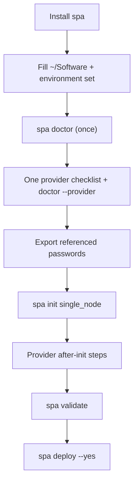

# Quick start

Agents: load `/spa`; this page is the step order, `/spa` owns the gates.

This is the minimum first lab: install spa, fill a shared Software directory, satisfy **one** provider, then deploy `single_node`. Installer flags, uninstall, and git clone live in [install.md](install.md). Day-2 operations live in the [user guide](user-guide.md). If you want an SVA, ITSI/ES, or a confirmed architecture file, use `/spa-create-config` instead of forcing `single_node`.

The default lab is **`single_node`** (minimum RAM and cost). `spa init list` names clustered topologies such as `cm_2idxc_sh`.

## 1. Install the framework

Controller Python **3.9 through 3.14** with the `venv` module.

```sh
curl -fsSL https://github.com/splunk/splunk-platform-automator/releases/latest/download/install.sh | sh
```

Add `~/.local/bin` to `PATH` if `spa` is not found. From an SPA checkout (`ansible.cfg` and `bin/spa`), use `bin/spa venv create --shared --yes` instead; see [install.md](install.md).

Optional: `spa skills install cursor`.

Flags, uninstall, extract, and git clone: [install.md](install.md).

## 2. Shared Software directory

Create `~/Software` **outside** `SPA_HOME`.

1. Download the current Linux **tgz** for [Splunk Enterprise](https://www.splunk.com/en_us/download/splunk-enterprise.html) and [Universal Forwarder](https://www.splunk.com/en_us/download/universal-forwarder.html). With `splunk_version` unset (the `single_node` default), spa uses the latest tarball it finds. Pinning `splunk_version` is optional; paths and version pins: [Prepare Software](user-guide.md#prepare-software). Download the Universal Forwarder now even though `single_node` leaves its forwarder host commented out; `spa doctor` warns without it, and most other topologies need it.
2. Extract PS baseconfig apps into the same tree (`Configurations - Base`, `Configurations - Index Replication`). Employees: [http://go/baseconfigs](http://go/baseconfigs). Others: Splunk Professional Services. Not a public Splunk.com download.
3. Optional license: place or symlink a top-level `*.lic` (typical name `Splunk_Enterprise.lic`). Trial labs may omit; `spa doctor` warns, `spa validate` does not fail for that alone.

Point spa at the directory once:

```bash
spa environment set --software-dir ~/Software
```

That also sets `baseconfig_dir` when unset. If Software is not a sibling of the env or of `SPA_HOME`, this step is required (typical for a prefix install). Sibling discovery and `paths.yml`: [Prepare Software](user-guide.md#prepare-software).

Confirm with `spa doctor` and fix every Software WARN and any FAIL. Later, `spa licenses list` and `spa config set splunk_defaults.splunk_license_file NAME` when using a file.

## 3. Provider checklist

Complete **one** of the following. Step 4 uses `PROVIDER` for the one you chose.

### CCM (employee-only)

`CCM_TOKEN` and an SSH key from [https://ccm.splunkits.io/](https://ccm.splunkits.io/). Depth: [CCM](ccm.md). `spa doctor --provider ccm` reports the token as **set / not set**.

### AWS

Terraform on PATH. IAM identity / `AWS_PROFILE` (create keys in the [IAM console](https://console.aws.amazon.com/iam/)). EC2 key pair in the **env region** plus a local PEM; create the pair in the [EC2 console](https://console.aws.amazon.com/ec2/). SPA does not create keys. A security group **already in that region**, default name `Splunk_Basic` (SPA does not create groups; [ROADMAP #58](../ROADMAP.md)). Inbound rules: [Example Basic AWS Security Group](aws.md#example-basic-aws-security-group-splunk_basic). Omit `subnet_id` to use the default subnet.

After init in step 4, before `spa validate`: `spa provider aws check-auth`, `spa provider aws survey --region REGION`, then `spa config set` for `terraform.aws.region`, AMI, `key_name`, `ssh_private_key_file`, and `security_group_names`. Do not keep example AMI or key names from `examples/providers/aws.yml`. `spa doctor --provider aws` names the Terraform install hint.

### Existing hosts (`external`)

OpenSSH client and a reachable Linux host per Splunk host in the topology. After init in step 4 (`--provider external`), before `spa validate`: `spa hosts register NAME --ssh-host HOST --user USER --key PATH --yes` for each host. SPA does not create, stop, or terminate those machines. `spa doctor --provider external`.

### VirtualBox

VirtualBox, HashiCorp Vagrant, and `vagrant-vbguest`. How to install those tools: [VirtualBox](install.md#virtualbox). `spa doctor --provider virtualbox`.

## 4. Secrets, create, validate, deploy

Export referenced passwords **before** `spa init` so init's set / not set list is already green. `spa validate` fails by variable name if one is still missing. Never print secret values. `single_node` references `SPLUNK_ADMIN_PASSWORD` only; clustered topologies also need their cluster secrets. See [Secrets](secrets.md).

```bash
# export SPLUNK_ADMIN_PASSWORD (and cluster secrets if the topology references them)
spa init --example single_node --provider PROVIDER ~/envs/my-lab
cd ~/envs/my-lab
# after init: finish your provider's step 3 items (AWS config set, external hosts register)
spa validate
spa deploy --yes
```

`PROVIDER` is the one chosen in step 3. Then open the printed `$SPA_ENV_DIR/config/index.html` and run `spa hosts list --status`. Teardown: `spa destroy --yes`.


