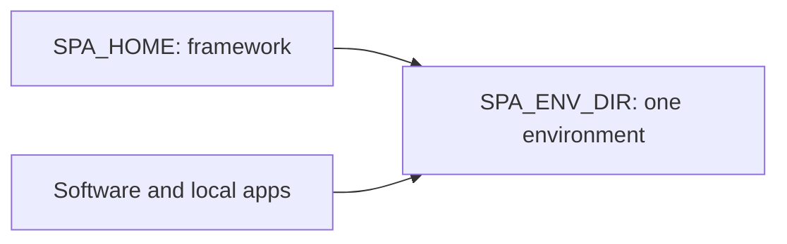
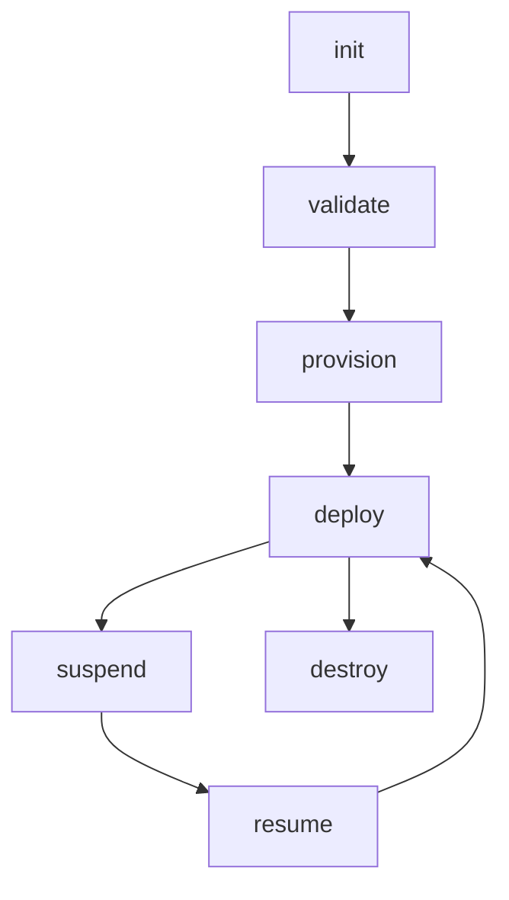
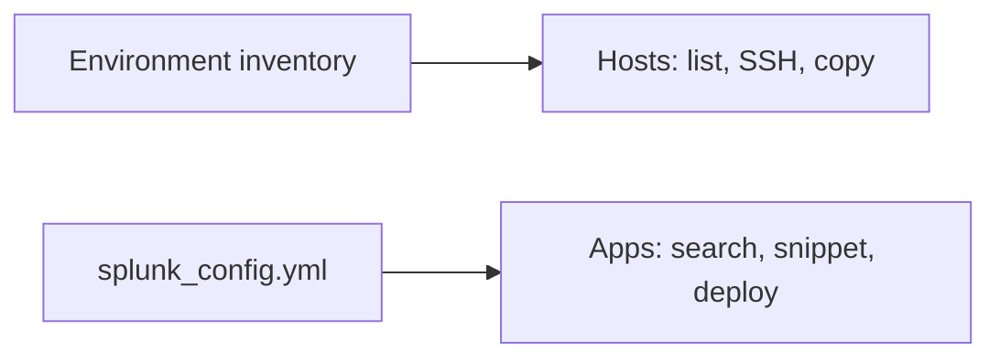

# Splunk Platform Automator user guide

SPA installs and configures Splunk Enterprise for testing, training, staging, and production. The operator interface is **`spa`**. Ansible, Terraform, and Vagrant are implementation details, not alternate operator CLIs.

## Start here

Install the framework first ([install guide](install.md)), then:

```bash
spa doctor
spa init --example cm_2idxc_sh --provider aws ~/envs/my-env
cd ~/envs/my-env
spa validate
spa provision --yes && spa deploy --yes
```

`spa deploy` runs an Ansible ping with become for the selected hosts after you confirm and before the playbook, then compares `splunk_architecture` with the machine. The expected value is the host override, then that host's `splunk_environments` entry, then `splunk_defaults`, then `amd64`. `spa hosts check` is that check on its own. `spa deploy --hosts ROLE` includes every config host in that role, including one that is not provisioned yet. `spa provision` does not run the check. Before `spa run` of a playbook that needs root, run `spa hosts check`.

Use `--provider virtualbox` with a topology such as `single_node` for local VMs. Before production, review the deployment-intent work tracked in [ROADMAP #80](../ROADMAP.md); default examples are intentionally permissive.

## Understand the paths



`SPA_HOME` is the installed framework or clone: `bin/spa`, playbooks, Terraform modules, and skills. `SPA_ENV_DIR` is one environment created by `spa init`: config, inventory, provider state, and optional `.spa.yml`. Keep Splunk installers and PS baseconfig apps in `Software/`; point local app storage at `apps_dir`.

`spa` resolves an environment by `--env NAME`, `SPA_ENV_DIR`, walking up from cwd to `.spa.yml`, then the registered default, and applies that environment to the command. Many environments can share one framework install. `spa environment list` shows registered names; use `spa environment set --default NAME` for commands run outside an env, or pass `spa --env NAME`. An older lab that already has `config/splunk_config.yml` or `.spa.yml` is registered with `spa env init NAME --force` from that directory or its parent (config is kept unless you also pass `--example`).

For an existing server, `spa init --example TOPOLOGY --provider external ENV`, then `spa hosts register NAME --address ADDRESS --user USER --key PATH --yes`. Registration checks SSH and writes the address, user, and key only in `inventory/hosts`. The config only needs `external:`. `spa validate` checks the config only. `spa deploy --yes` pings with become and compares `splunk_architecture` with the machine before the playbook, using the host override, then `splunk_environments`, then `splunk_defaults`, then `amd64`. `spa hosts check` is that check without deploying. SPA does not create, shut down, or terminate an external machine. `spa provision` in an external-only environment says so and does not ask to proceed. In a mixed environment it still asks, because the managed hosts change, and it names the external hosts it leaves alone.

## Prepare Software

Keep Splunk installers, Professional Services baseconfig apps, and license files **out of** `SPA_HOME`. Point every env at one shared directory:

```bash
spa init --software-dir ~/Software --example cm_2idxc_sh my-lab
```

`spa validate` and `spa deploy` fail if that directory is missing or incomplete.

1. Create a directory, typically `~/Software` (not inside `SPA_HOME`).
2. Download Linux **tgz** installers and put them in that directory:
   - [Splunk Enterprise](https://www.splunk.com/en_us/download/splunk-enterprise.html)
   - [Splunk Universal Forwarder](https://www.splunk.com/en_us/download/universal-forwarder.html)
   - Filenames look like `splunk-<version>-<build>-linux-amd64.tgz` and `splunkforwarder-<version>-<build>-linux-amd64.tgz`. The version must match `splunk_version` in config.
3. Copy Splunk **Professional Services Best Practices baseconfig apps** into the same tree and extract them. They are not a public Splunk.com download. Splunk / Cisco employees can download them from [https://go2.cisco.com/baseconfigs](https://go2.cisco.com/baseconfigs). Everyone else: contact Splunk Professional Services. Typical layout: `Configurations - Base` and `Configurations - Index Replication`.
4. If you have a Splunk license, place or symlink it as **`Splunk_Enterprise.lic`** in that directory (`spa licenses` lists basenames for config). Trial-only labs can omit licenses.

```text
~/Software/Configurations - Base/...
~/Software/Configurations - Index Replication/...
~/Software/splunk-<version>-<build>-linux-amd64.tgz
~/Software/splunkforwarder-<version>-<build>-linux-amd64.tgz
~/Software/Splunk_Enterprise.lic
```

User-level defaults live in `~/.config/spa/paths.yml` (not secrets). `spa environment set --env-dir DIR` changes the parent for name-only init (omit when it is `~/Splunk-Platform-Automator`). `spa environment set --software-dir DIR` / `--baseconfig-dir DIR` / `--apps-dir DIR` set the shared installer, PS baseconfig, and local-apps trees for every env. `--software-dir` also sets `baseconfig_dir` when you do not pass `--baseconfig-dir`. If a path key has never been set, `spa init` stores the first directory it is given or discovers; later one-off init options remain specific to that env and do not replace an established global. `spa environment set --default NAME` selects a registered environment. `spa environment set --provider virtualbox` writes `~/.config/spa/providers.yml`; aws is the implicit default and does not create that file. One-off dest (`spa init /my/custom/folder/my-lab` or `--env-dir` + `--name`) does not change the default parent.

Later per-env knobs on `spa environment set --env NAME` will write that env’s `.spa.yml`, not `paths.yml`.

## Configure an environment

`$SPA_ENV_DIR/config/splunk_config.yml` is the source of truth. Start from a composed topology and provider rather than copying a large example:

```bash
spa init list
spa config search cluster
spa config explain splunk_idxclusters.idxc_name
spa validate
```

When a setting uses `{{ lookup('env', 'NAME') }}`, export the variable to a non-empty value before `spa validate`, `spa provision`, or `spa deploy`. `spa init` lists each referenced name as `set` or `not set` and does not stop. A missing value fails with the variable name, for example `SPLUNK_ADMIN_PASSWORD`, and does not print the value. `spa config set PATH --from-env NAME` can record the reference before the variable exists.

The Pydantic schema enforced by `spa validate` owns types and allowed values. The feature catalog owns decision guidance and example snippets; editing commands never apply those snippets. Browse every key in [config.md](config.md) (`spa --no-agent config schema --markdown`). Discover a key with `spa --agent config explain PATH`. `spa --agent config explain PATH` prints the one mutation command for that feature and does not apply it. Author an existing scalar or map with `spa --agent config set PATH VALUE`. Append a new non-app identity, such as a host or cluster, with `spa --agent config add SELECTOR JSON_OBJECT`. Use one `spa --agent config merge --file FILE` transaction for a deliberate multi-setting fragment. Use `spa config topology` and `spa config provider` for layout replacement. App entries stay on `spa apps add`. Finish with `spa --agent validate`. Use `spa aws --json` for live regions, AMIs, instance types, and network values; use `spa licenses` and `spa validate --check-licenses` for license selection. See the [configuration editing contract](config-editing.md). For a full clustered ITSI example, follow [Build a clustered ITSI config](config-walkthrough.md).

Universal-forwarder outputs always go to all indexers today. UF → heavy forwarder (or a single indexer) is not a config knob; see `spa config explain splunk_hosts.splunk_outputs` and [ROADMAP](../ROADMAP.md).

## Run the lifecycle



| Job | Command |
| --- | --- |
| Create compute and inventory | `spa provision --yes` |
| Install or reconcile Splunk | `spa deploy --yes` |
| Limit a supported operation | `--hosts HOST_OR_ROLE` |
| Stop compute and retain disks | `spa suspend --yes` |
| Start compute | `spa resume --yes` |
| Remove managed infrastructure | `spa destroy --yes` |
| Discover other playbooks | `spa run list` |
| Inspect a playbook | `spa run NAME --help` |
| Show a run transcript | `spa logs list` / `spa logs RUN_ID` / `spa logs --last` / `spa logs --follow` |
| Replay the captured native Ansible transcript | `spa logs --last --ansible-output` |
| Show event times on that transcript | `spa logs --last --ansible-output --timestamps` |
| Color that transcript | `spa logs --last --ansible-output --color` |
| Show native Ansible output during a run | `spa deploy --yes --ansible-output` |
| Increase Ansible verbosity and show native output | `spa deploy --yes -v` through `-vvvv` |

Provider selection comes from `terraform.aws` or `virtualbox:` in config. Do not remove a live host from config and run `spa provision`; the current Terraform flow can terminate it. See [AWS](aws.md) for cloud decisions and [Upgrade](upgrade.md) for the ordered distributed-upgrade workflow.

Mutating Ansible/Terraform work writes a timestamped JSONL transcript under `$SPA_ENV_DIR/logs/`. On a TTY, humans see **one live line per named group that actually runs** (for example `Deploy  App deployment · Search Head Cluster apps`), with the active host and task while work is running and compact counters when it settles. Rolling upgrade groups settle once per host and include installed and target Splunk versions when reported by the playbook. There is no `[3/10]` index; unused topology simply never appears. `spa run` of every first-party playbook uses the same compact grouping, with play-name fallback for work outside known roles and functions. Failures print immediately. `NO_COLOR` / piped stderr stay uncolored. Agents keep a small JSON envelope on stdout plus `data.log`; they must not ingest the transcript unless you asked to debug a failure. Terraform instance changes (`instance_type`, disk) fold into the provision plan/apply line. On VirtualBox, provisioning shows one line per VM (`Provision  VM idx1`) built from Vagrant's output, and a Vagrant error is printed before the group closes as `failed`.

## Complete commands in the shell

Press Tab twice to list matches for every `spa` command, subcommand, and flag. Tab also lists local values for the argument being typed, such as host names, config paths, playbooks, environments, and run ids. `spa shell` then Tab lists host names from the local config. Agents use `spa agent schema`.

Load the function from [Install](install.md#shell-completion).

## Work with hosts and apps



Open `$SPA_ENV_DIR/config/index.html` after deploy for Splunk Web links. Use:

```bash
spa hosts list --status
spa hosts ssh HOST
spa hosts copy SOURCE HOST:DESTINATION
```

VirtualBox images normally log in as OS user `vagrant`; Splunk runs as OS user `splunk`. The former is an account name, not an instruction to call the Vagrant CLI.

Find application metadata and update config without maintaining an app-ID table in docs:

```bash
spa --agent apps search QUERY
spa --agent apps add APP_ID --roles ROLE
spa --agent validate
spa apps download APP_ID --yes
spa deploy --yes
```

See [Apps](apps.md) for SPA routing, customizations, ITSI, removal, and verification.

## Protect secrets

Use `lookup('env', 'NAME')` or quoted Ansible Vault values; never commit plaintext credentials. Agents report variables as set/not set and never print values. See [Secrets](secrets.md).

## Where to go next

- [Clustered ITSI config](config-walkthrough.md): copy-paste `spa config` and `spa apps` example
- [Commands](commands.md): generated CLI catalog (`spa agent schema --markdown`)
- [Settings](config.md): generated key list (`spa config schema --markdown`)
- [Install](install.md): install, uninstall, VirtualBox, WSL2
- [Apps](apps.md): routing and app lifecycle
- [AWS](aws.md): AWS and Terraform through `spa`
- [Upgrade](upgrade.md) and [Migrate](migrate.md)
- [Contributing](contributing.md) and [AGENTS.md](../AGENTS.md)
